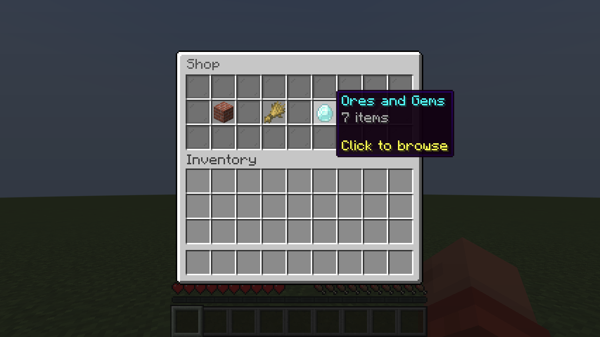
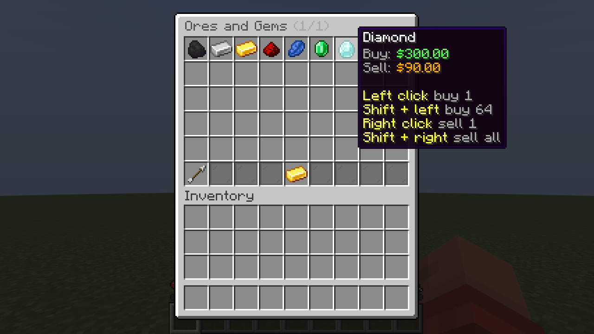
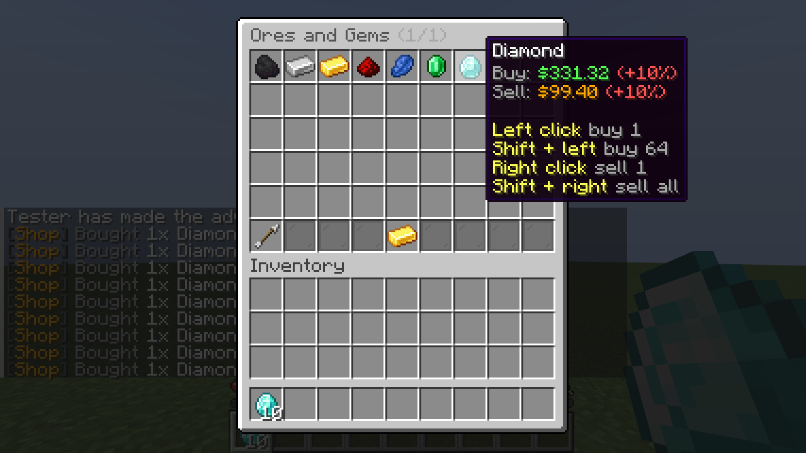

# Tradepost

Shop plugin for Paper 1.21.11. You buy and sell from a chest menu, money goes through Vault, and prices go up or down depending on what players buy and sell. Prices and trade history are saved in SQLite or MySQL.





After buying 10 diamonds, the price went up 10%:



## What it does

Type `/shop` to open a menu of categories. Inside a category, left click buys one item and shift + left click buys a stack. Right click sells one and shift + right click sells everything of that item in your inventory. The shop only takes plain items, renamed or enchanted ones are skipped.

Every unit bought makes the next one a bit more expensive and every unit sold makes it cheaper. Prices stay between a minimum and a maximum you set, and when nobody trades they drift back to the base price. Stacks are priced per unit too.

DB stuff runs async.

Without Vault, or with Vault but no economy plugin, the shop still opens and shows prices, but trades are refused and the console says why.

## Requirements

- Paper 1.21.11 or a fork of it, Java 21
- Vault and an economy plugin, for buying and selling
- PlaceholderAPI, optional

## Commands and permissions

| Command | Permission | Default |
| --- | --- | --- |
| `/shop` | `tradepost.use` | everyone |
| `/shop <category>` | `tradepost.use` | everyone |
| `/shop price <item>` | `tradepost.price` | everyone |
| `/shop history` | `tradepost.history` | everyone |
| `/shop reload` | `tradepost.reload` | op |

`tradepost.admin` gives all of them. `/market` is an alias.

## Configuration

Items live in `config.yml`, grouped by category. The key of each item is its id, used by the database and the placeholders, so it has to be unique.

```yaml
categories:
  ores:
    title: "<aqua>Ores and Gems"
    icon: DIAMOND
    slot: 14
    items:
      iron_ingot: { buy: 25.0, sell: 8.0 }
      diamond:
        buy: 300.0
        sell: 90.0
        pricing:
          step: 0.01
          max-multiplier: 3.0
      name_tag:
        buy: 250.0
        dynamic: false
```

Leave out `buy` or `sell` to make an item sell-only or buy-only. `material` defaults to the id. In the global `pricing` section, `step` is how much each unit moves the price, `min-multiplier` and `max-multiplier` are the limits, and `recovery-half-life-minutes` is how fast it goes back to normal. Any item can override those or turn them off.

Broken entries get skipped with a warning in console.

All player-facing text is in `messages.yml` with [MiniMessage](https://docs.advntr.dev/minimessage/format.html) formatting. `/shop reload` reloads both files. The storage section is only read at startup.

### MySQL

```yaml
storage:
  type: mysql
  table-prefix: tradepost_
  mysql:
    host: localhost
    port: 3306
    database: minecraft
    username: minecraft
    password: "change me"
```

MariaDB works with the same settings. The connection pool is HikariCP, shaded and relocated inside the jar.

## Placeholders

| Placeholder | Example |
| --- | --- |
| `%tradepost_buy_<item>%` | `10.33` |
| `%tradepost_sell_<item>%` | `2.58` |
| `%tradepost_change_<item>%` | `+29.1`, percent away from the base price |

## Building

```
./gradlew build
```

The plugin jar is `build/libs/tradepost-<version>.jar`. The build runs the tests too.

## Tests

Unit tests use MockBukkit, SQLite and H2.

`tools/e2e` has what I use to test on a real server: `test-economy` is a small Vault economy for local testing, `bot.js` is a [mineflayer](https://github.com/PrismarineJS/mineflayer) client that clicks through the menu, and `rcon.py` sends console commands. The MySQL code has only been run against H2 so far, not a real MySQL server.

## License

MIT, see [LICENSE](LICENSE).
